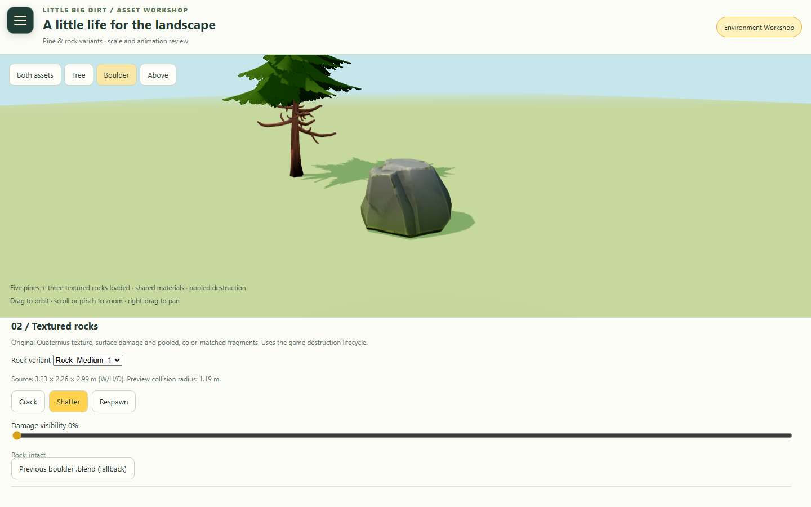
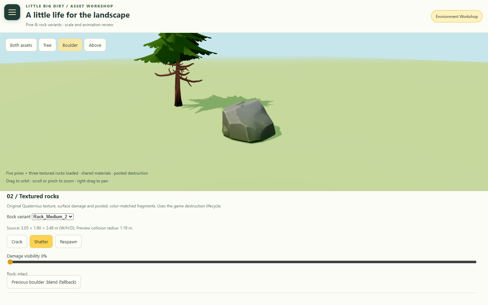
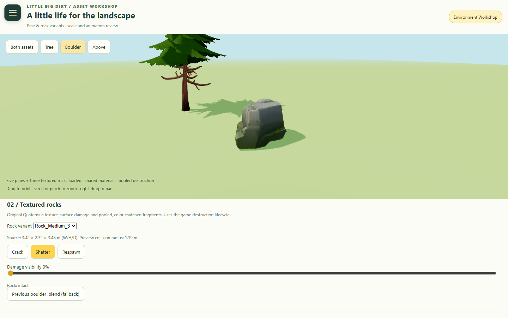
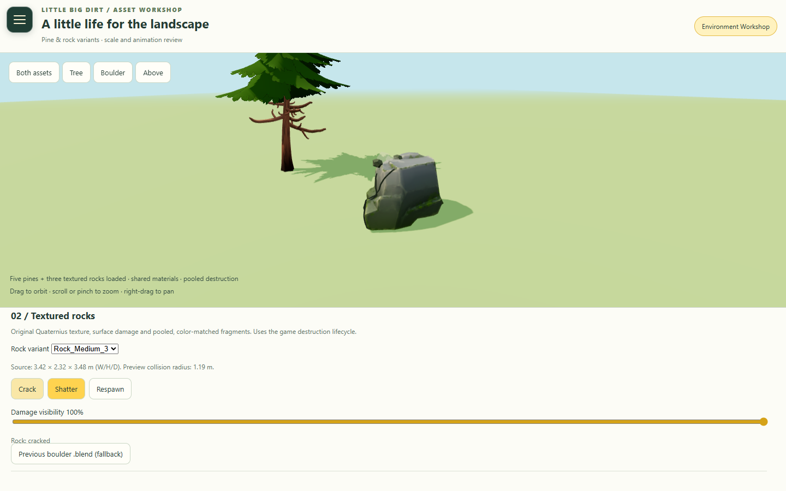
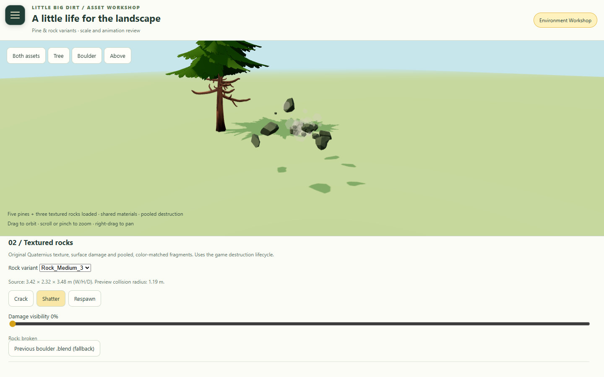

# Textured interactive rocks

Only Rock_Medium_1, Rock_Medium_2, Rock_Medium_3 and their Rocks_Diffuse texture
were imported from Quaternius Stylized Nature MegaKit Standard (CC0). Existing
interactive rock positions, counts and physics settings are unchanged. Tiny
decorative stones remain disabled. Pine assets and their rendering code are
unchanged. Nothing was pushed or merged.

## Source inspection and conversion

Dimensions were measured from every OBJ before integration; OBJ has no unit
metadata. Blender imports at scale 1 and exports glTF in meters, without guessing
an extra conversion factor. Dirty is 4.612 units tall; Stinky is 3.9045.

| Model | Source width | Source height | Source depth | Original bottom Y | Triangles |
| --- | ---: | ---: | ---: | ---: | ---: |
| Rock_Medium_1 | 3.225 | 2.260 | 2.989 | -0.271131 | 342 |
| Rock_Medium_2 | 3.049 | 1.899 | 2.479 | -0.050841 | 244 |
| Rock_Medium_3 | 3.420 | 2.316 | 3.476 | -0.315644 | 522 |

Blender 4.5.3 LTS imported the supplied OBJ/MTL files. The MTLs refer to an absent
`C:/Rocks_Diffuse.png`; the conversion explicitly reconnects the supplied texture.
UVs, normals and triangle counts are retained. Every model is separately centered
in X/Z and given a base pivot at Y=0. No subdivisions, fracture generation or
additional scenery were added. The exported diffuse PNG is byte-identical to the
source. GLBs share that external PNG; keep their directory together.

- Original OBJ/MTL, texture and license: `assets/source/rocks/quaternius/`.
- Editable packed Blender source: `assets/blender/rocks/quaternius_rocks.blend`.
- Runtime GLBs, shared texture and measurements: `assets/models/rocks/quaternius/`.
- Rebuild: `blender --background --python tools/blender/import_quaternius_rocks.py -- "<MegaKit directory>"`.
- Validate geometry, UVs and texture: `python tools/validate_quaternius_rocks.py`.

Each visual is uniformly scaled to the existing horizontal collision circle
(`rock.r * .85`) with small seeded scale variation. This preserves the flatter
second shape and the distinct silhouettes. At `rock.r=1`, normalized dimensions
before variation are approximately 1.609×1.128×1.492, 1.487×0.926×1.209 and
1.571×1.064×1.597 (W/H/D). Existing interactive radii are 0.45–1.65, so these remain
cartoon driving obstacles, substantially below the vehicle roofs.

The visual wrapper cancels the original mesh's initial pitch/roll, seats its
corrected base against the existing group height, and retains later wobble/rolling
motion. Following visual review, rocks are additionally embedded by 12% of their
existing radius (about 5–20 cm) so uneven bottoms blend into terrain. The wrapper
does not move colliders, terrain, spawn points or fragment physics.

## Configuration

The existing `worldAppearance` object in `WorldEnvironmentConfig.js` owns these
settings. They also appear in Settings → Environment and use the existing tuning
store, persistence, reset and environment export. Reload Play to apply.

| Setting | Default | Effect |
| --- | ---: | --- |
| `rockMinScale` | 0.96 | Lower visual-size multiplier around each existing collision circle. |
| `rockMaxScale` | 1.04 | Upper multiplier; all axes scale uniformly. Keep near 1 for collision alignment. |
| `rockGroundInset` | 0.12 | Burial as a fraction of radius. Higher sits deeper; 0 seats the lowest point at terrain height. |
| `rockMedium1Weight` | 1 | Relative frequency of Rock_Medium_1. |
| `rockMedium2Weight` | 1 | Relative frequency of Rock_Medium_2. |
| `rockMedium3Weight` | 1 | Relative frequency of Rock_Medium_3. |

Equal weights give equal odds, rather than exact counts in a finite map. Zero
excludes a variant; all-zero weights fall back to equal odds. A separate coordinate
hash chooses model, yaw and size without consuming the world-generation random
sequence. Respawn retains the same visual record, model and transform.

## Destruction and rendering

`RockVisuals.js` owns visuals; `RockInteractionSystem.js` is unchanged. Both Dirty
and Stinky still use the existing spatial grid, collision correction, thresholds,
resistance, cooldowns, fragment count/pool, gravity, bounce, fading, safe respawn and
reforming. No rigid bodies or runtime fracture were introduced.

Intact, stationary rocks use three instanced meshes, one per supplied model.
Each GLB loads once per library; all three share one material and one texture.
Only wobbling, damaged, moving or reforming rocks use individual mesh hierarchies.
The adapter allocates no geometry or render objects during per-frame updates.
Existing instanced frustum culling and the rest of the environment/detail rendering
remain in place.

A cracked rock keeps the supplied textured model visible. Two shared seam meshes
per variant follow the actual imported surface, prepared at load time. Breaking
hides that model through the existing lifecycle; broken/reforming rocks retain the
existing non-solid rules. The existing five chunk geometries are reused within
the existing pool. They have no UV attribute, so their materials use colors sampled
from the supplied models' texture UVs, with mild tonal variation, instead of the
old gray material. Small rock chips in impact dust use the same palette. Existing
random fragment radii, launches, bouncing and settling remain unchanged; visual
orientation varies separately. Configured counts of 3–6 still work, cycling chunk
geometry when six are requested.

The original cartoon_boulder.glb, cartoon_boulder_fractured.glb and original Blender
source remain available. The old fractured asset supplies geometry only; its gray
materials are not used by the new destruction visuals. Adapter disposal restores
the prior procedural visuals, materials and fragment hook. Asset-load failures
retain the game's existing procedural fallback.

## Workshop and validation

Environment Workshop has a selector for each rock variant and uses the same
RockInteractionSystem/RockVisuals pair for Crack, Shatter and Respawn. The Respawn
button fast-forwards the preview clock, including debris expiry, then lets the
normal reform animation run. Damage visibility replaces the former exploded-seam
inspection. The fixed preview, orbit/zoom, scrollable controls and navigation remain.

Validation performed:

- Original UV coordinates, normals, triangle counts, base pivots, packed Blender
  source and byte-identical shared diffuse texture verified.
- Every GLB loaded in Edge; three game model requests total, three geometries,
  one shared material and one shared texture. No browser errors or asset warnings.
- Real-geometry integration tests verify unchanged rock positions/radii, all three
  batches, seated/inset bases, exact idle/animated transforms, damage, destruction,
  pool reuse, moving-rock transitions, recovery and cleanup.
- Browser fixtures using both Dirty and Stinky's existing collision envelopes and
  tuning passed cracking, breaking, nonblocking broken rocks, fragment scattering
  and expiry, occupied-spawn delay, and restoration for every variant (six cases).
- Desktop 1440×900, portrait 390×844 and landscape 844×390 fixed-preview/independent
  scrolling checks passed. These are desktop Edge viewport checks.
- Full project test command (`python tools/check_project.py`, after building) passed.
- A short stationary desktop Edge sample measured median frame intervals of 7 ms
  both before and after. The latest sample had p95 near 13.9 ms and median total
  draw calls including shadows of 276 for both. These are sample-specific values,
  not sustained driving or cross-device performance guarantees.

Physical iPhone/Safari rendering, touch gestures, memory use, sustained frame rate
and thermal behavior remain unverified. The runtime assets add about 2.56 MB,
dominated by the single original 2048×2048 texture. Portable Blender was used only
for authoring; no runtime dependencies were added.

Raw browser results: [rock-browser-validation.json](rock-browser-validation.json).

| Intact 1 | Intact 2 | Intact 3 |
| --- | --- | --- |
|  |  |  |

| Cracked | Breaking | Restored |
| --- | --- | --- |
|  |  |  |
